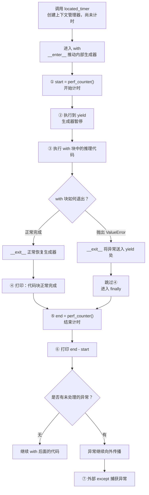

# AI Infra Python 进阶复习

学习主题：闭包、类方法、生成器、yield、装饰器、try finally 与上下文管理器。

更新日期：2026-09-11。本次补充类与实例的区别、range 与迭代器、生成器耗尽、装饰器展开、raise 以及计时上下文的执行流程。

适用基础：已能用 Python 完成常见算法题，开始阅读训练、推理和数据管线代码。示例使用 Python 3.10+，仅依赖标准库；设备名称只作为字符串处理，不需要 GPU 或 NPU。

本文根据既有学习问题重新组织，示例为教学代码，不是框架源码或项目性能结论。对应课程：[AIInfraGuide 第 1 章](https://caomaolufei.github.io/AIInfraGuide/guides/模块一-前置知识/第1章-编程语言基础/)。

## 1 先掌握执行顺序

| 概念 | 需要回答的问题 | 推理工程中的用途 |
| --- | --- | --- |
| 闭包 | 外层函数结束后，内部函数怎样继续使用外层变量？ | 保存阈值、原函数、配置 |
| `@classmethod` | 调用方法时，自动传入的是哪个类？ | 从字符串或配置创建对象 |
| 生成器和 `yield` | 谁推动计算？在哪里暂停和恢复？ | 分批读取样本 |
| 装饰器 | 函数名现在指向谁？原函数何时运行？ | 为函数统一添加计时、日志 |
| `try/finally` | 返回或异常传播前，需要先做什么？ | 清理资源、恢复状态 |
| `@contextmanager` | 如何在一段代码前后执行配套操作？ | 计时、文件与锁的生命周期 |

把它们连起来：闭包可以保存原函数，从而构造包装型装饰器；生成器提供暂停点，`contextmanager` 利用这个暂停点包围 `with` 代码块；`finally` 让退出路径经过清理代码。类方法则解决对象创建和方法绑定的问题。

## 2 闭包 从函数对象开始

`f` 表示函数对象，`f()` 表示调用函数。函数可以赋值、传参和返回。

```python
def make_filter(threshold):
    def accept(score):
        return score >= threshold
    return accept

loose = make_filter(0.5)
strict = make_filter(0.9)
print(loose(0.8))   # True
print(strict(0.8))  # False
```

执行 `make_filter(0.5)` 时，参数 `threshold` 绑定到 `0.5`，随后创建内部函数 `accept`，最后返回这个函数对象。此时没有执行 `accept` 的函数体。

执行 `loose(0.8)` 时才进入 `accept`。它通过闭包访问外层函数中的 `threshold`。另一次调用 `make_filter(0.9)` 建立另一份外层绑定，所以两个过滤器可以使用不同阈值。

**闭包可以理解为：函数，以及它访问外层函数变量所需的绑定。** 嵌套定义本身不代表一定存在闭包；内部函数要使用外层函数的变量。只引用模块全局变量，也不属于这里说的外层函数闭包。

闭包不是把变量的值全部拍成快照。调用时读取绑定，因此循环中的延迟绑定需要注意：

```python
def make_bad():
    return [lambda: i for i in range(3)]

def make_good():
    return [lambda i=i: i for i in range(3)]

print([f() for f in make_bad()])   # [2, 2, 2]
print([f() for f in make_good()])  # [0, 1, 2]
```

第二种写法用默认参数在每次定义时保存当前对象；若该对象可变，这仍不是深拷贝。作用域和延迟绑定参见 [Python 类与作用域教程](https://docs.python.org/3/tutorial/classes.html)。

内层若要重新绑定外层函数变量，使用 `nonlocal`：

```python
def make_counter():
    count = 0
    def increment():
        nonlocal count
        count += 1
        return count
    return increment

counter = make_counter()
print(counter(), counter())  # 1 2
```

只读取 `count` 不需要 `nonlocal`。对外层列表做 `append` 是修改对象，也不需要；执行 `items = []` 是重新绑定，才需要区分作用域。

## 3 类方法 cls 是类 self 是实例

类本身也是运行时对象；实例是调用类创建出的具体对象。下面的 `Device` 是我们定义的设备描述，不会打开设备或加载驱动。

```python
from dataclasses import dataclass

@dataclass
class Device:
    kind: str
    index: int

    def label(self):
        return f"{self.kind}:{self.index}"

    @classmethod
    def parse(cls, text: str) -> "Device":
        kind, index = text.split(":")
        return cls(kind=kind, index=int(index))

    @staticmethod
    def valid_kind(kind):
        return kind in {"cpu", "cuda", "npu"}

class NPUDevice(Device):
    pass

d = Device.parse("cuda:0")
print(d.label())                         # cuda:0
print(Device.label(d))                   # cuda:0
print(Device.valid_kind("npu"))          # True
print(type(NPUDevice.parse("npu:0")).__name__)  # NPUDevice
```

`@dataclass` 根据字段生成初始化等方法。`Device.parse("cuda:0")` 自动把 `Device` 作为 `cls` 传入：先拆出字符串，再转换编号，最后用 `cls(...)` 创建实例。由 `NPUDevice` 调用时，`cls` 就是 `NPUDevice`，前提是其构造接口兼容。

| 方法 | 典型调用 | 自动传入 | 用途 |
| --- | --- | --- | --- |
| 实例方法 | `d.label()` | `d` → `self` | 读取这个实例的数据 |
| 类方法 | `Device.parse(text)` | `Device` → `cls` | 与类有关的操作、备选构造入口 |
| 静态方法 | `Device.valid_kind(kind)` | 无 | 放在类中的相关工具函数 |

`cls` 和 `self` 是约定名称，绑定机制来自方法类型。只把普通方法第一个参数改名为 `cls`，不会自动变成类方法。静态方法也可以通过显式对象访问属性，只是没有隐式传入的类或实例。类方法不一定要返回实例；本例选择用它创建对象。[classmethod 官方说明](https://docs.python.org/3/library/functions.html#classmethod)

这里 `parse` 是教学版，格式错误会产生 `ValueError`，也没有调用 `valid_kind` 自动校验。类型注解不会代替运行时输入检查。

### 类方法不会自动创建子类

`@classmethod` 只负责自动传入类对象。`return cls(...)` 才是本例创建实例的代码；类方法也可以仅打印类名或返回一个数字，完全不创建实例。

```text
Device.parse("cuda:0")
    → cls 收到已经存在的 Device 类
    → 执行 Device(kind="cuda", index=0)
    → 得到 Device 实例，没有产生新类
```

### 子类定义与 pass 的含义

前面示例中的两行可以这样拆解：

| 代码 | 含义 |
| --- | --- |
| `class NPUDevice` | 定义一个名为 NPUDevice 的新类 |
| `(Device)` | 指定父类为已经存在的 Device |
| `pass` | 空语句，表示暂时不增加或重写实现 |

继承关系由 `(Device)` 指定，`pass` 仅用于占位。子类虽然没有增加代码，仍然是不同于父类的类，可以使用继承的方法。没有重写 `__init__` 时，本例沿用父类的初始化逻辑。

```python
# 接上面的 Device 与 NPUDevice 定义
a = Device.parse("cuda:0")
b = NPUDevice.parse("npu:0")
print(type(a).__name__)             # Device
print(type(b).__name__)             # NPUDevice
print(issubclass(NPUDevice, Device)) # True：类之间的继承关系
print(isinstance(b, Device))        # True：子类实例也是父类的实例
```

执行顺序是：先通过 `class NPUDevice(Device)` 定义子类，再调用它继承的 `parse`。第二次调用中 `cls` 是 `NPUDevice`，所以 `cls(...)` 创建子类实例。若将这里硬编码为 `Device(...)`，即使通过子类调用，也会返回父类实例。

## 4 生成器和 yield 保存进度 按需执行

普通的同步 `def` 函数体中包含 `yield`，它就是生成器函数。调用该函数得到生成器对象；推动这个对象才执行函数体。

```python
def stages():
    print("开始读取")
    yield "batch-1"
    print("继续读取")
    yield "batch-2"
    print("读取结束")

g = stages()       # 函数体尚未运行
print(next(g))     # 开始读取，然后打印 batch-1
print(next(g))     # 继续读取，然后打印 batch-2
print(next(g, "耗尽"))  # 读取结束，然后打印 耗尽
```

第一次 `next` 从函数开头执行到第一个 `yield`，将值交给消费端并暂停。第二次从暂停处恢复，而不是重头执行。执行到函数末尾或 `return` 时结束迭代；不带默认值的 `next` 会收到 `StopIteration`，`for` 会自动处理这个结束信号。[yield 语言参考](https://docs.python.org/3/reference/expressions.html#yield-expressions)

要分清三个对象：`stages` 是生成器函数，`stages()` 是生成器对象，`yield "batch-1"` 交出的是字符串。不是 `yield` 把生成器对象返回给调用者。

| 对象 | 可以做什么 | 是否自动从头重来 |
| --- | --- | --- |
| 列表等可迭代对象 | 用 `iter(obj)` 获取迭代器 | 列表每次可以生成新迭代器 |
| 迭代器 | 用 `next(it)` 逐次取得元素 | 通常不可以 |
| 生成器对象 | 一种迭代器，还支持 `send/throw/close` | 不可以，需重新调用生成器函数 |

### 分批处理与对象引用

```python
def batches(items, batch_size):
    if batch_size <= 0:
        raise ValueError("batch_size 必须为正数")
    batch = []
    for item in items:
        batch.append(item)
        if len(batch) == batch_size:
            yield batch
            batch = []
    if batch:
        yield batch

g = batches(range(5), 2)
print(list(g))  # [[0, 1], [2, 3], [4]]
print(list(g))  # []
```

`yield batch` 交出列表对象，不会复制列表。`batch = []` 创建新列表，使旧批次保留原内容；若改成 `batch.clear()`，消费端已拿到的同一列表也会被清空。除非接口明确约定了缓冲区复用，否则不要把清空旧列表当作通用优化。

生成器减少的是预先物化全部结果的需求。其内存还取决于输入、局部状态、单条数据大小及消费端是否保存历史批次，不能一概写成 O(1)。上面为了展示输出使用 `list(g)`，这恰好会收集全部结果。工程上更常见的是逐批处理后释放引用。

另外，`batches(items, 0)` 本身不执行校验，第一次迭代才会报错；生成器没有自动并发、自动预取或自动加速的能力。

### range 是可迭代对象 不是列表或迭代器

`batches(range(5), 2)` 的第一个参数是一个 `range` 对象，描述 `0、1、2、3、4` 这个整数序列，不会预先构造一个保存全部元素的列表。它是可迭代的不可变序列，但本身不是迭代器。[range 官方说明](https://docs.python.org/3/library/stdtypes.html#ranges)

| 表达式 | 对象类型 | 可迭代 | 是迭代器 |
| --- | --- | --- | --- |
| `[0, 1, 2, 3, 4]` | 列表 | 是 | 否 |
| `range(5)` | range 对象 | 是 | 否 |
| `iter(range(5))` | range 迭代器 | 是 | 是 |
| `batches(range(5), 2)` | 生成器对象 | 是 | 是 |

“可迭代”描述能力，不是列表的另一个名字。生成器开始执行到 `for item in items` 时，`for` 会从 `items` 获取迭代器，再逐个取值。

```python
r = range(5)
print(r[2])      # 2：支持索引
it = iter(r)
print(next(it))  # 0
print(next(it))  # 1
# next(r)       # 会报 TypeError，因为 range 本身不是迭代器
```

### 为什么第二次 list(g) 是空列表

`list(g)` 会不断从生成器取得元素，并将它们收集到一个新列表中，直到遇到 `StopIteration`。第一次转换会将 `g` 消费到结束，第二次访问的是同一个已经耗尽的生成器，不会重新运行函数体。

```text
第一次 list(g)
    → 取得 [0, 1]
    → 取得 [2, 3]
    → 取得 [4]
    → 再次索取时生成器结束
    → 收集结果为 [[0, 1], [2, 3], [4]]

第二次 list(g)
    → 立刻遇到结束信号
    → 没有取得任何新元素，结果为 []
```

这里是 `list` 推进了生成器，`print` 只是打印转换后的列表。若想反复使用同一份结果，可以保存列表；若想重新计算，就重新调用生成器函数：

```python
# 接上面的 batches 定义
saved = list(batches(range(5), 2))
print(saved)  # [[0, 1], [2, 3], [4]]
print(saved)  # [[0, 1], [2, 3], [4]]：反复使用已保存的结果

print(list(batches(range(5), 2)))  # 每次创建一个新的生成器
print(list(batches(range(5), 2)))  # 两次均得到完整批次

r = range(5)
print(list(r))  # [0, 1, 2, 3, 4]
print(list(r))  # [0, 1, 2, 3, 4]
```

同一个 `range` 每次可提供新迭代器，因此可以重新遍历；生成器自身保存当前进度，耗尽后不会自动重置。保存列表便于复用，但会占用保存全部结果所需的内存。

### send yield from 和 return 的补充

```python
def exchange():
    received = yield "ready"
    yield received * 2

g = exchange()
print(next(g))      # ready
print(g.send(6))    # 12
g.close()
```

`received = yield "ready"` 先交出 `"ready"` 并暂停；恢复时，`send(6)` 的 `6` 才成为 `yield` 表达式的值，赋给 `received`。`next(g)` 相当于 `g.send(None)`；尚未启动的生成器不能先接收非 `None` 的值。

`yield from iterable` 可用于逐项转交一个可迭代对象的元素，例如拼接数据分片；在委托生成器时，它也处理 `send/throw` 等协议交互。生成器中的 `return value` 会结束生成器，将值放入 `StopIteration.value`，不会额外产出一个普通元素。

## 5 try finally 先清理 再离开

```python
def answer():
    try:
        print("计算")
        return 42
    finally:
        print("清理")

print(answer())  # 依次打印：计算、清理、42
```

执行 `return 42` 时先确定待返回对象，随后运行 `finally`，最后才将结果交给调用者。如果 `try` 中抛出异常，也会先经过 `finally`，然后继续传播未处理的异常。

| 结构 | 作用 |
| --- | --- |
| `try` | 执行需要考虑异常的操作 |
| `except SomeError` | 捕获匹配的异常，并决定如何处理 |
| `else` | `try` 正常完成、没有异常且没有提前跳出时执行 |
| `finally` | 在离开该结构前执行清理 |

`finally` 不是异常处理器。除非另有 `except` 或改变控制流，异常仍会向外传播。在 `finally` 写 `return` 会覆盖待返回值或压住异常，因此清理代码通常不要这样写；清理自身抛出异常也会影响原控制流。[try 与 finally 语言参考](https://docs.python.org/3/reference/compound_stmts.html#the-try-statement)

“一定执行”有边界：解释器正常执行退出路径才有此保证；进程强杀、断电不能依赖它。生成器暂停在 `yield` 处时也没有离开 `try`，此时不会立刻执行 `finally`。

### raise 主动抛出异常

`raise ValueError("推理失败")` 分为两个动作：先调用 `ValueError(...)` 创建异常对象，再由 `raise` 抛出它。只创建异常对象不会中断执行。

```python
error = ValueError("推理失败")
print("异常对象已创建，但还没有抛出")
# raise error  # 执行这一行才会抛出异常

def check_batch_size(size):
    if size <= 0:
        raise ValueError("batch_size 必须大于 0")
    return size

try:
    check_batch_size(0)
    print("检查通过")  # 不会执行
except ValueError as error:
    print("参数错误：", error)

print("继续后面的工作")  # 异常已由 except 处理，因此会执行
```

抛出异常后，当前位置之后的普通语句会被跳过，控制流寻找能够处理它的异常处理器，并经过相应的 `finally` 清理。若异常一直未被处理，会继续传播到调用者。

处理异常时，不带参数的 `raise` 可以重新抛出当前异常。适用于“记下日志，但仍需上层处理”的情况：

```python
# 接上面的 check_batch_size 定义
def validate_with_log(size):
    try:
        return check_batch_size(size)
    except ValueError:
        print("记录错误日志")
        raise  # 重新抛出当前异常

try:
    validate_with_log(0)
except ValueError:
    print("外层收到异常")
```

若当前没有正在处理的异常，单独使用 `raise` 会产生 `RuntimeError`。`ValueError` 通常表示参数值不合适；“推理失败”只是流程演示文案，实际工程中应根据失败原因选择异常类型。[raise 官方说明](https://docs.python.org/3/reference/simple_stmts.html#the-raise-statement)

## 6 装饰器 保存原函数 在调用前后增加行为

先看去掉复杂类型标注后的版本：

```python
from functools import wraps
from time import perf_counter

def timed(fn):
    @wraps(fn)
    def wrapper(*args, **kwargs):
        start = perf_counter()
        try:
            return fn(*args, **kwargs)
        finally:
            elapsed_ms = (perf_counter() - start) * 1000
            print(f"{fn.__name__}: {elapsed_ms:.3f} ms")
    return wrapper

@timed
def preprocess(values):
    return [value / 255.0 for value in values]

print(preprocess([0, 255]))  # 先打印耗时，再打印 [0.0, 1.0]
```

上述归一化只是语法示例，真实模型的预处理必须遵循模型约定。

### 两个阶段不能混淆

装饰发生在执行函数定义语句时：创建原函数对象，将其传给 `timed`，创建并返回 `wrapper`，最后把名字 `preprocess` 绑定到包装函数。等价写法是 `preprocess = timed(preprocess)`。这是运行中的定义阶段，常发生在模块导入时，不是“完全不在运行时”。

调用发生在之后的 `preprocess([0, 255])`：

```text
preprocess 这个名字 → wrapper
                       记录 start
                       用闭包变量 fn 调用原函数
                       得到归一化结果
                       finally 计算并打印耗时
                       返回结果给调用者
```

这里 `fn` 是闭包变量；`start` 是每次 `wrapper` 调用的局部变量，不是被它捕获的外层变量。`return wrapper` 返回函数对象；若写成 `return wrapper()`，则会在装饰阶段就调用包装函数。

`*args` 收集位置参数，`**kwargs` 收集关键字参数；调用 `fn(*args, **kwargs)` 时再展开转交。这样包装函数能转发不同形状的参数。

应用 `@wraps(fn)` 会将原函数的名称、文档等元信息更新到包装函数，并设置 `__wrapped__`。没有它时，`preprocess.__name__` 会是 `wrapper`；闭包中原函数的 `fn.__name__` 本来就没变。`wraps` 不会消除包装开销，也不会让 Python 自动检查类型。[wraps 官方说明](https://docs.python.org/3/library/functools.html#functools.wraps)

`perf_counter()` 的差值单位是秒，适合测量耗时，包含等待时间；它不是 Unix 时间戳，也不保证实际测量具有纳秒精度。[计时函数说明](https://docs.python.org/3/library/time.html#time.perf_counter)

### timed 与 wraps 的展开方式

判断装饰目标，要看 `@...` 紧接着下面定义的函数，而不是装饰器括号内出现的名字。

| 写法 | 被装饰的函数 | 等价展开 |
| --- | --- | --- |
| `@timed` 后定义 `preprocess` | preprocess | `preprocess = timed(preprocess)` |
| `@wraps(fn)` 后定义 `wrapper` | wrapper | `wrapper = wraps(fn)(wrapper)` |

因此 `@wraps(fn)` 不等价于 `fn = wraps(fn)`。`wraps(fn)` 先返回一个装饰器，再由这个装饰器接收 `wrapper`，更新它的元信息并返回它。

下面是去掉两处 `@` 后的完整可运行例子：

```python
from functools import wraps

def traced(fn):
    def wrapper(*args, **kwargs):
        print("准备调用")
        return fn(*args, **kwargs)

    decorate_wrapper = wraps(fn)
    wrapper = decorate_wrapper(wrapper)  # 合起来是 wraps(fn)(wrapper)
    return wrapper

def double_values(values):
    """将输入元素乘以二。"""
    return [x * 2 for x in values]

double_values = traced(double_values)
print(double_values.__name__)  # double_values
print(double_values.__doc__)   # 将输入元素乘以二。
print(double_values([1, 2]))   # 先打印 准备调用，再打印 [2, 4]
```

| 名字 | 角色 |
| --- | --- |
| `fn` | 原函数，既供调用，也提供名称与文档等元信息 |
| `wraps` | 标准库工具，根据原函数创建更新包装函数元信息的装饰器 |
| `wrapper` | 我们自己定义的包装函数，实际执行附加逻辑与参数转发 |

`wrapper` 是普通名字，改成 `inner` 也可以。`wraps` 不负责调用原函数；真正执行原函数的是 `fn(*args, **kwargs)`。即使包装函数的 `__name__` 已显示原函数名，实际执行路径仍经过包装函数。

### 为什么使用闭包

它让每个包装函数持有自己的原函数引用，写法简短，适合这里的需求。但不是唯一方案，可调用类实例也能保存原函数。

直接写 `timed_call(fn, *args, **kwargs)` 同样可以正确计时，并统一处理清理逻辑。区别在于调用方式：装饰器让后续通过包装后的函数名发起的调用都带上行为；普通工具函数让每个调用点显式选择是否计时。

堆叠 `@a`、`@b` 时，结果是 `f = a(b(f))`，应用顺序从下向上。装饰器也不都采用“返回包装函数”形式，例如注册型装饰器可以登记函数后返回原函数。

### 再读类型标注

```python
from collections.abc import Callable
from typing import ParamSpec, TypeVar

P = ParamSpec("P")
R = TypeVar("R")

def identity_decorator(fn: Callable[P, R]) -> Callable[P, R]:
    return fn
```

`P` 描述参数规格，`R` 表示返回类型。`Callable[P, R] -> Callable[P, R]` 表达“装饰前后的参数与返回类型保持对应”。计时器内部可用 `*args: P.args, **kwargs: P.kwargs` 和 `-> R` 配合它，主要服务于静态检查与编辑器，不负责运行时转发，转发仍由 `*args/**kwargs` 完成。

## 7 contextmanager 用一个暂停点包围代码块

```python
from contextlib import contextmanager

@contextmanager
def session():
    print("1 获取资源")
    try:
        yield "handle"
        print("3 正常完成")
    finally:
        print("4 释放资源")

with session() as handle:
    print("2 使用", handle)
```

正常输出：

```text
1 获取资源
2 使用 handle
3 正常完成
4 释放资源
```

`session()` 在装饰后返回上下文管理器。进入 `with` 时，其 `__enter__` 推动内部生成器到 `yield`；产出的 `"handle"` 赋给 `as handle`。执行块体期间，生成器暂停。退出块体时，`__exit__` 恢复生成器或把块体异常送入暂停点。

成功进入一次上下文需要恰好产出一次；正常退出时生成器必须结束，不能再产出第二次。资源获取阶段也可能在第一次 `yield` 前失败，此时块体不会执行。[contextmanager 官方说明](https://docs.python.org/3/library/contextlib.html#contextlib.contextmanager)

异常路径：

```python
try:
    with session() as handle:
        print("2 使用", handle)
        raise ValueError("推理失败")
except ValueError:
    print("5 外部收到异常")
```

顺序为 `1 → 2 → 4 → 5`，不会打印 `3 正常完成`。块体异常在生成器的 `yield` 处重新抛出，所以普通的“yield 后一行”会被跳过，而 `finally` 仍执行。清理后，异常继续向外传播。

若生成器中 `except ValueError` 后正常结束而不重新 `raise`，该异常会被视为已经处理，程序继续到 `with` 后面；不会回到块体报错那一行继续。因此，只想记日志时记得重新抛出。

### start yield end 在代码中的具体位置

`start` 和 `end` 都是程序员定义的普通局部变量，`contextmanager` 不会自动创建它们。下面用编号对应代码与流程图：

```python
from contextlib import contextmanager
from time import perf_counter

@contextmanager
def located_timer(name):
    start = perf_counter()                    # ① 开始计时
    try:
        yield                                 # ② 暂停，交给 with 块
        print("代码块正常完成")                 # ④ 仅正常路径执行
    finally:
        end = perf_counter()                  # ⑤ 结束计时
        elapsed_ms = (end - start) * 1000
        print(f"{name}: {elapsed_ms:.3f} ms")   # ⑥ 打印耗时

try:
    with located_timer("推理"):
        print("执行推理")                       # ③ with 块
        raise ValueError("推理失败")            # ③ 模拟异常
except ValueError as error:
    print("外部捕获：", error)                  # ⑦ 外部处理
```



图中假设计时与打印本身没有报错。`with` 块运行期间，生成器暂停，`start` 保留在这次生成器调用的局部状态中；退出时恢复生成器才执行 `end = perf_counter()`。

正常与异常的顺序也可直接用下面的文字版复习：

```text
正常：① start → ② yield 暂停 → ③ with 块
    → 正常恢复 → ④ 正常完成 → ⑤ end → ⑥ 耗时

异常：① start → ② yield 暂停 → ③ with 块抛异常
    → 异常送入 yield → 跳过④ → ⑤ end → ⑥ 耗时
    → 异常继续传播 → ⑦ 外部捕获
```

示例异常路径的输出如下，具体耗时因运行环境而异：

```text
执行推理
推理: 某个耗时 ms
外部捕获： 推理失败
```

删去 `raise ValueError(...)` 那行，便会在“执行推理”之后打印“代码块正常完成”，然后打印耗时，不会进入外部 `except`。

测量范围是①到⑤之间的全部时间，包括 `with` 块、退出处理以及④处的打印。真实计时器通常去掉④这类演示日志。普通 `yield` 后的代码会被未处理异常跳过，因此将 `end` 放在 `finally` 中，才能同时覆盖正常退出和异常退出。

### 与普通生成器的区别

普通 `for` 不会因为块体报错或 `break`，就自动把异常 `throw` 进生成器或调用它的 `close()`。不要将 `contextmanager` 的退出协议套到普通生成器上。持有文件等资源且可能提前结束时，应明确关闭：

```python
from contextlib import closing

def rows(path):
    with open(path, encoding="utf-8") as file:
        yield from file

# 使用时：with closing(rows(path)) as stream:
#             for row in stream:
#                 ...
# 即使提前 break 或消费端异常，退出 closing 也会调用 stream.close()。
```

生成器暂停期间，内部 `with open` 仍可能保持文件打开；最终耗尽、显式关闭等才会推进相应清理。不要依赖垃圾回收时机管理文件。[closing 官方说明](https://docs.python.org/3/library/contextlib.html#contextlib.closing)

## 8 综合示例 分批模拟推理并计时

下面的代码块可以单独复制运行。每个函数名表示的工作与真实推理脚本相近，但推理仅由 `sum` 模拟。

```python
from contextlib import contextmanager
from dataclasses import dataclass
from functools import wraps
from time import perf_counter

def timed(fn):
    @wraps(fn)
    def wrapper(*args, **kwargs):
        start = perf_counter()
        try:
            return fn(*args, **kwargs)
        finally:
            print(f"{fn.__name__}: {(perf_counter() - start) * 1000:.3f} ms")
    return wrapper

@contextmanager
def timer(name):
    start = perf_counter()
    try:
        yield
    finally:
        print(f"{name}: {(perf_counter() - start) * 1000:.3f} ms")

@dataclass
class Config:
    batch_size: int

    @classmethod
    def parse(cls, text):
        size = int(text)
        if size <= 0:
            raise ValueError("batch_size 必须为正数")
        return cls(size)

def batches(items, batch_size):
    if batch_size <= 0:
        raise ValueError("batch_size 必须为正数")
    batch = []
    for item in items:
        batch.append(item)
        if len(batch) == batch_size:
            yield batch
            batch = []
    if batch:
        yield batch

@timed
def infer(batch):
    return sum(batch)

config = Config.parse("2")
with timer("完整流程"):
    for batch in batches(range(5), config.batch_size):
        print("结果", infer(batch))
```

结果依次为 `1、5、4`。每批打印一次 `infer` 耗时，最后打印完整流程耗时。后者包含循环、批次生成和内部打印等开销，不应等同于纯推理时间。

对应关系：`Config.parse` 使用类方法创建配置；`batches` 使用生成器按需产出；`timed` 的闭包保存 `infer` 原函数；`timer` 用上下文管理器包住任意代码块；两处 `finally` 让正常返回和异常退出都经过计时逻辑。

同步计时装饰器若直接包住生成器函数，通常只测到创建生成器对象的时间；包住 `async def` 则通常只测到创建协程对象的时间。实际迭代或 `await` 要在合适的测量范围内执行。

CUDA 运算通常异步提交，主机计时不一定包含设备计算完成。真实 GPU 测量要按指标采用同步或 CUDA Events，并考虑预热与同步扰动；本例仅演示 CPU 同步代码。[PyTorch CUDA 执行说明](https://docs.pytorch.org/docs/2.14/notes/cuda.html#asynchronous-execution)

## 9 原学习记录中的纠正项

| 需要修正的说法 | 准确理解 |
| --- | --- |
| 闭包是装饰器保存原函数的唯一方法 | 可调用对象也能保存状态；闭包是常见且简洁的选择 |
| 装饰一次之后，每次调用没有额外开销 | 每次仍有包装函数、计时和打印等成本 |
| 计时 wrapper 捕获了 start | 本例仅 `fn` 来自外层函数；`start` 是每次调用的局部变量 |
| wraps 让 fn.__name__ 变正确 | 它更新的是 wrapper 的元信息，原函数的名称本来就存在 |
| 消费端抛异常，生成器会强制关闭 | 普通迭代没有这一保证，应明确管理关闭 |
| yield 的内存一定 O(1) | 取决于保留状态、输入大小、批次和消费端行为 |
| finally 捕获了异常 | finally 执行清理；except 才匹配并处理异常 |
| contextmanager 保证事务式回滚 | 它提供进入退出机制；恢复哪些状态由代码决定 |
| dataclass 内 `version: str = "1"` 是纯类变量 | 它是带默认值的数据类字段；类变量应使用 `ClassVar[str]` |
| frozen=True 让所有内部数据不可变 | 它限制字段赋值，不会递归冻结字段内的列表等对象 |

数据类字段与 `ClassVar` 的区别见 [dataclasses 官方说明](https://docs.python.org/3/library/dataclasses.html#class-variables)。

原记录还有两条 AI Infra 建议不应照搬：`torch.cuda.empty_cache()` 释放未使用的缓存块，不能释放仍被活跃张量占用的显存，也不是通用的泄漏修复；通信失败后无条件在 `finally` 调用 `dist.barrier()`，可能因其他 rank 无法参与而等待或超时，不能保证避免挂死。参见 [empty_cache](https://docs.pytorch.org/docs/2.14/generated/torch.cuda.memory.empty_cache.html) 与 [barrier](https://docs.pytorch.org/docs/2.14/distributed.html#torch.distributed.barrier)。

## 10 自测与答案

先尝试回答，再看下方答案。

1. `f = make_filter(0.7)` 时是否已经判断过某个 score？
2. 为什么 `return wrapper` 不能随便换成 `return wrapper()`？
3. `SubDevice.parse(...)` 中的 `cls` 是什么？
4. 调用生成器函数时，第一行的打印是否执行？
5. `yield batch` 后改用 `batch.clear()`，旧批次会怎样？
6. `try` 里 `return 42`，`finally` 里只打印日志，先打印什么、最后返回什么？
7. with 块内抛异常，yield 后面的普通代码和 finally 各会怎样？
8. for 循环 break 是否保证关闭生成器？
9. 把普通计时装饰器用于生成器函数，测量范围哪里容易出错？
10. `@classmethod` 会自动创建子类吗？`class NPUDevice(Device): pass` 中谁指定继承？
11. `range(5)`、`iter(range(5))` 和 `list(range(5))` 分别是什么？
12. 为什么对同一个生成器执行两次 `list(g)`，第二次为空？怎样复用结果？
13. `@wraps(fn)` 放在 `wrapper` 定义前，正确的展开式是什么？
14. 创建 `ValueError(...)` 与 `raise ValueError(...)` 有什么区别？裸 `raise` 做什么？
15. 计时上下文中，`start` 在什么时候执行？为什么 `end` 放在 `finally`？

### 参考答案

1. 没有，只创建并返回保存阈值绑定的函数。
2. 前者返回函数对象供以后调用；后者立刻调用并返回其执行结果。
3. `SubDevice`，而不是固定的父类。
4. 不执行，首次推进生成器时才执行。
5. 如果消费端持有的是同一个列表，就会看到清空及后续修改。
6. 先执行日志打印，再返回 `42`。
7. 未处理异常会跳过普通代码，仍执行 finally，随后继续向外传播。
8. 不保证，应显式 close 或使用 closing 等机制。
9. 可能只测到生成器对象创建，漏掉消费时实际执行的工作。
10. 不会，类方法只自动接收类。`(Device)` 指定继承，`pass` 是空语句；本例 `cls(...)` 创建的是实例。
11. 分别是可迭代的 range 对象、range 迭代器和列表。
12. 第一次转换已经耗尽生成器。可以保存第一次得到的列表反复使用，或重新创建生成器重新计算。
13. `wrapper = wraps(fn)(wrapper)`，元信息来源是 fn，被装饰的是 wrapper。
14. 前者只创建异常对象，后者主动抛出。裸 raise 重新抛出当前正在处理的异常。
15. 进入 with、内部生成器首次推进时执行 start；end 放在 finally 可覆盖块体正常完成与异常退出两条路径。

复习时优先用代码追踪执行顺序。能解释综合例子中的每次调用、暂停、恢复与退出，再补 `ParamSpec` 等类型细节。
